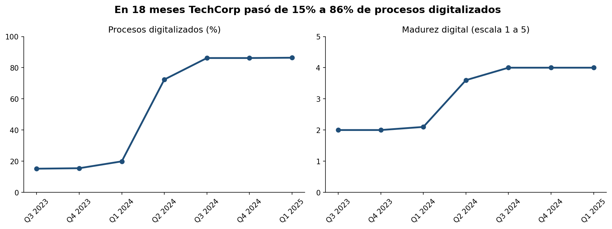
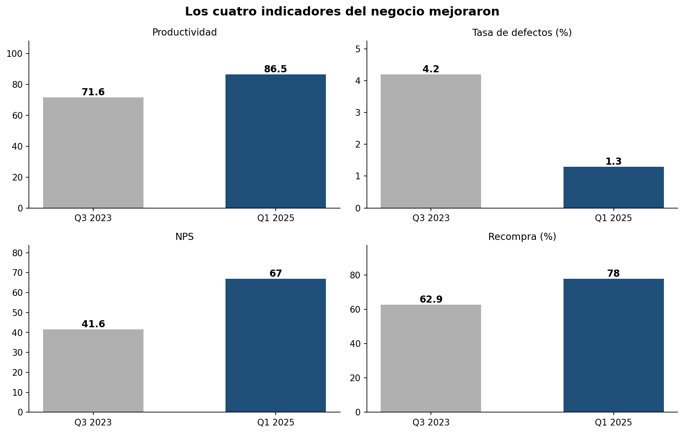
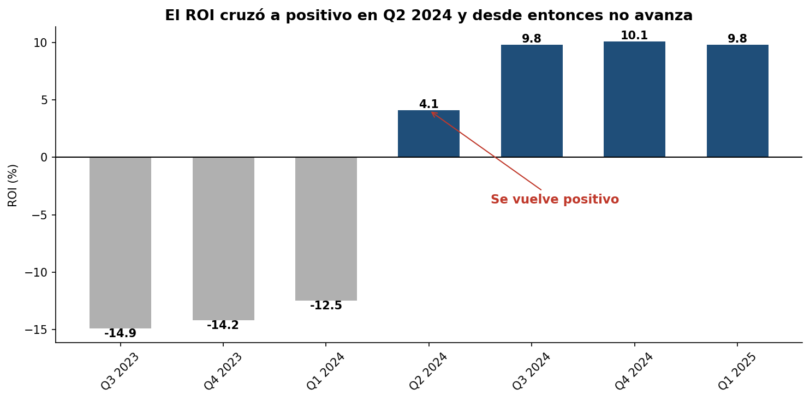
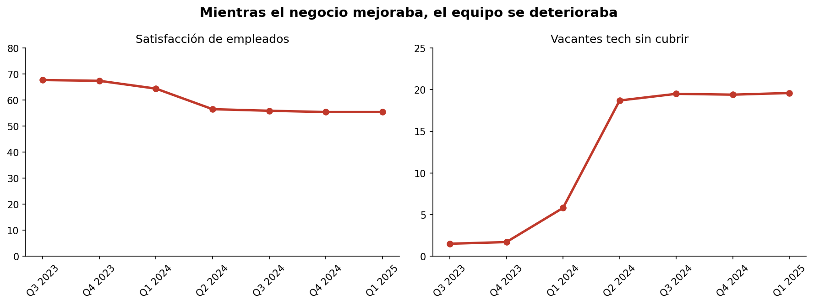

# Narrativa de datos: transformación digital de TechCorp

Análisis de 18 meses de transformación digital en una empresa de manufactura,
con una recomendación de inversión dirigida al CEO.

**Autor:** Martín Alfaro Ossandón · [LinkedIn](https://www.linkedin.com/in/martin-alfaro-ossandon/) · m.alfarossandon@gmail.com

## El problema

TechCorp lleva 18 meses invirtiendo en transformación digital y los resultados
son mixtos. El CEO necesita decidir si continúa la inversión. Los datos son 97
registros semanales con 29 indicadores, entre julio de 2023 y marzo de 2025.

## Lo que encontré

Agrupé los datos por trimestre en lugar de mirarlos semana a semana, y ahí
apareció lo que no se veía:

| | Q3 2023 | Q1 2024 | **Q2 2024** | Q1 2025 |
|---|---|---|---|---|
| Procesos digitalizados | 15% | 20% | **72%** | 86% |
| Productividad | 71,6 | 75,1 | **85,7** | 86,5 |
| NPS | 42 | 43 | **62** | 67 |
| ROI | −14,9% | −12,5% | **+4,1%** | +9,8% |
| Satisfacción empleados | 67,7 | 64,4 | **56,5** | 55,4 |
| Vacantes tech sin cubrir | 1,5 | 5,8 | **18,7** | 19,6 |

**Todo el avance ocurrió en un solo trimestre.** Desde Q2 2024 los indicadores
de negocio llevan cuatro trimestres planos, mientras la satisfacción de los
empleados perdió 12 puntos y las vacantes técnicas sin cubrir se multiplicaron
por trece.

Los datos muestran que ambas cosas ocurren en el mismo período. No demuestran
que una cause la otra, y el análisis no lo afirma.

## La conclusión

> La transformación digital ya se pagó, pero lleva cuatro trimestres estancada,
> y el freno dejó de ser tecnológico para pasar a ser de talento.

La recomendación no es continuar ni detener la inversión, sino **redirigirla**:
cubrir las vacantes técnicas, destinar parte del presupuesto de tecnología a
capacitación interna, y medir la satisfacción de empleados con el mismo peso que
la productividad.

## Visualizaciones

**El avance de la digitalización**

**Los resultados del negocio**

**La rentabilidad, y dónde se detuvo**

**El costo que no aparecía en el reporte**

## Contenido del repositorio

| Carpeta | Qué contiene |
|---|---|
| `notebook/` | El análisis completo en Jupyter: limpieza, agregación y visualizaciones |
| `graficos/` | Los cuatro gráficos en PNG |
| `documentos/` | Estructura narrativa, presentación ejecutiva y storyboard con script |
| `datos/` | El dataset original |

## Cómo ejecutar el análisis

### Google Colab

1. Abrir el archivo `notebook/analisis_techcorp.ipynb` en Google Colab.
2. Seleccionar **Runtime → Run all**.
3. El notebook descargará el dataset público desde GitHub.
4. Se ejecutarán la limpieza, la agregación trimestral y la generación de cuatro visualizaciones.

**Dependencias:** pandas y matplotlib, declaradas en [requirements.txt](requirements.txt).

**Datos:** [datos_techcorp.csv](datos/datos_techcorp.csv).

**Nota:** La ejecución ha sido verificada en Google Colab. La compatibilidad con entornos locales todavía requiere ajustes en la gestión de rutas.

## Herramientas

Python · pandas · matplotlib · Jupyter (Google Colab)

## Sobre la limpieza de datos

Dos ajustes antes de analizar:

- La columna `trimestre` traía mayúsculas inconsistentes (`Q3 2023` y `q3 2023`),
  lo que producía doce trimestres donde había siete.
- Ordené por fecha antes de agrupar, para que los trimestres quedaran en orden
  cronológico y no alfabético.

---

Trabajo desarrollado para la Especialidad en Análisis de Datos de Desafío Latam,
módulo de Fundamentos de la Narrativa de Datos.
